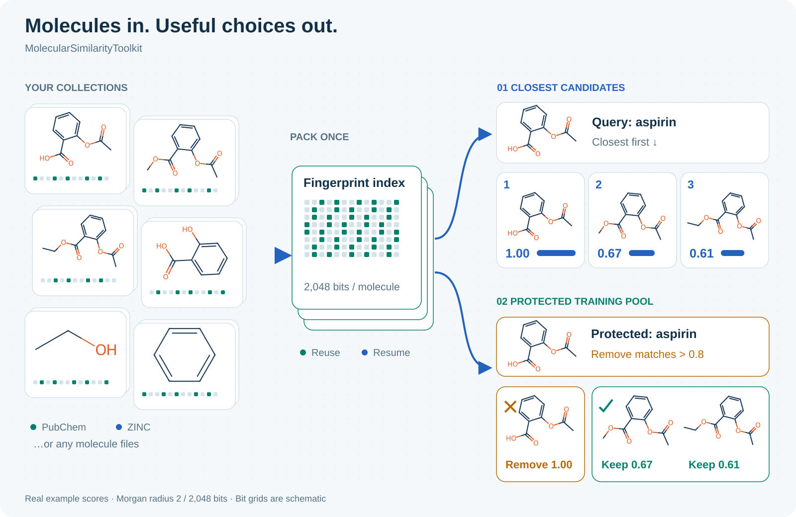

# Molecules in. Useful choices out.

You have a small set of molecules for testing your model and a much bigger
collection for training. This tool removes molecules that look too similar
to your protected set. It can also find the closest molecules to a query.



The two jobs use the same reusable fingerprint index. CPU searches run through
FPSim2; RDKit prepares molecules. Files and completed tasks stay on disk so a
failed job can resume.

## Start with a tiny example

From an authorized checkout, using Python 3.11–3.13:

```bash
uv sync --locked --group dev --extra docs
uv run python examples/quickstart.py
```

The example builds two small indexes, protects validation and test, exports a
training pool, and ranks three candidates for each query.

Read the [API guide](api.md), then choose [chemistry rules](chemistry.md) and
[input mappings](data.md) for your data. The [cluster guide](hpc.md) shows how to
run the same tasks using PBS or Slurm.

## Exact means exact under your rules

The default score compares Morgan radius-2, 2,048-bit fingerprints. It removes
stereochemistry and retains charges, salts, tautomers, and isotope labels.
Other leakage—such as duplicated experiments or copied labels—needs separate
checks. A fingerprint is not a unique molecular identity.

## Credits

[FPSim2](https://github.com/chembl/FPSim2) provides packed-fingerprint search.
[RDKit](https://www.rdkit.org/) provides chemistry and fingerprints. Apache Arrow,
DuckDB, NumPy, and PyTables support the storage and computation workflow.
